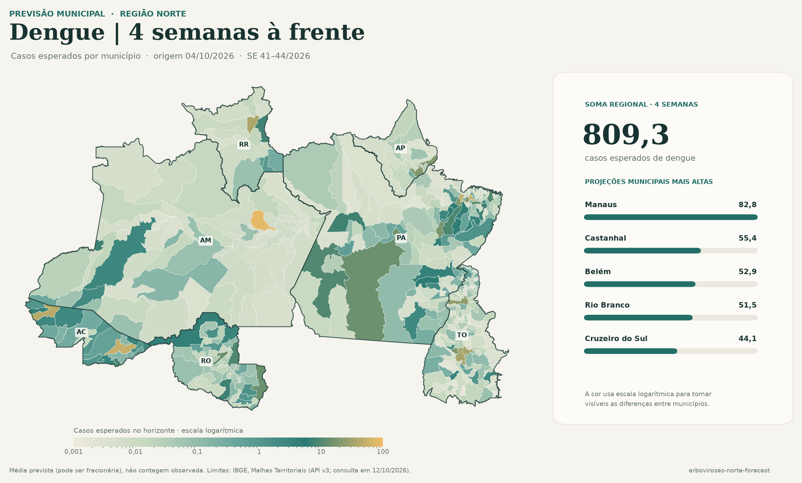
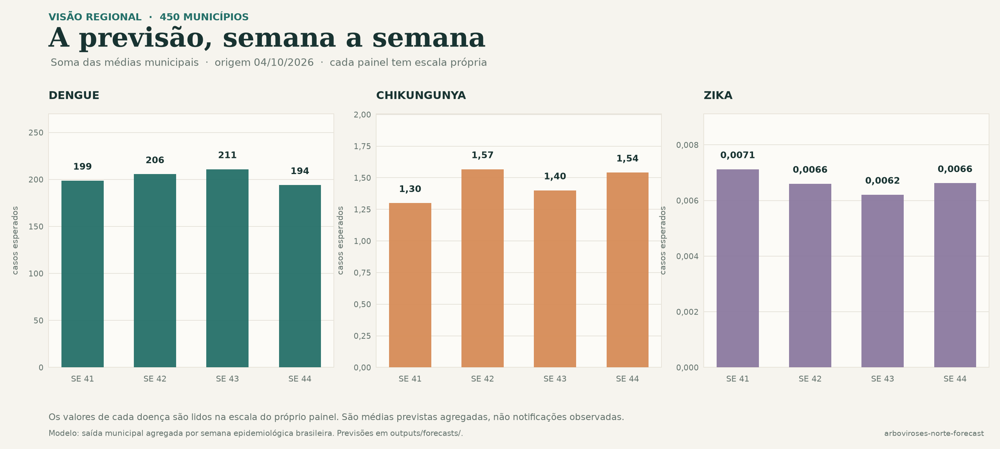

# Previsão de arboviroses na Região Norte

Pipeline em Python para estimar casos semanais de dengue, chikungunya e zika por município de residência, com agregação opcional por estado. O modelo neural usa PyTorch e produz previsões probabilísticas para as quatro semanas seguintes.

**Execução em 12/10/2026:** 50 ZIPs anuais oficiais (cerca de 914 MB) foram baixados; o painel e os modelos usam a janela comum de 2016 a 2026 e incluem 450 municípios do Norte. No teste retrospectivo parcial até 2026-W32, a WAPE foi **86,5% para dengue, 100,5% para chikungunya e 100,1% para zika**. O teste foi consultado durante o desenvolvimento e não é uma avaliação independente. Dados, modelos, previsões e relatórios detalhados ficam em `data/` e `outputs/`, fora do Git; os resultados e sua interpretação estão em [docs/initial-run-results.md](docs/initial-run-results.md).

## Visualização das previsões

As figuras mostram a saída municipal da execução registrada, com origem em 04/10/2026 e previsões para as semanas epidemiológicas 41–44. Os valores são médias previstas; podem ser fracionários e não representam notificações observadas.



*O mapa agrega a previsão de dengue ao longo das quatro semanas e usa escala de cor logarítmica. Os limites municipais vêm da [Malha Territorial do IBGE](https://www.ibge.gov.br/geociencias/organizacao-do-territorio/malhas-territoriais/15774-malhas-territoriais.html), consultada em 12/10/2026. A geografia posiciona as previsões no mapa; clima, solo e cobertura da terra não são usados como atributos do modelo.*



*Cada painel tem escala vertical própria; compare os valores dentro de cada doença. Os totais semanais são a soma das médias previstas nos 450 municípios.*

Para recriar as figuras com previsões locais em `outputs/forecasts/` e o cadastro municipal em `data/raw/`:

```powershell
python -m pip install -e ".[visuals]"
python scripts/generate_readme_visuals.py --origin-date 2026-10-04
```

O script consulta somente as geometrias municipais do IBGE para desenhar o mapa; não baixa dados de casos.

## Uso

Requer Python 3.11–3.14 e acesso à internet para baixar recursos do Ministério da Saúde e, na primeira preparação, a lista municipal oficial do IBGE. A instalação do PyTorch pode ser grande; use a instalação compatível com o hardware seguindo a [página oficial do PyTorch](https://pytorch.org/get-started/locally/).

```powershell
py -3.12 -m venv .venv
.\.venv\Scripts\Activate.ps1
python -m pip install --upgrade pip
python -m pip install -e ".[train]"
```

O download histórico completo pode exigir bastante disco e tráfego. Para começar com período comparável entre as três doenças:

```powershell
arboviroses catalog
arboviroses download --start-year 2016 --end-year 2026
arboviroses prepare --start-year 2016
arboviroses fit --start-year 2016 --epochs 30
arboviroses predict
```

O modelo usa 2016 em diante como janela comum entre as três doenças. Os recursos anteriores continuam disponíveis nos catálogos, mas não entram nesta versão porque os formulários e códigos de classificação mudaram; harmonizar esses anos exige mapeamento histórico específico antes do uso.

`prepare` mantém o cadastro municipal do IBGE, quando acessível. Se a conexão com o IBGE não estiver disponível, o modo `auto` segue com os municípios observados e registra a limitação. Para exigir o cadastro completo, use `arboviroses prepare --registry-mode required`; para trabalhar apenas offline, use `--registry-mode observed`.

Use `arboviroses predict --level uf` para agregar por estado. Pode filtrar com `--uf PA` ou consultar um município pelo código Sinan de seis dígitos ou IBGE de sete dígitos, por exemplo `--municipality 1501402`.

No treino, o modelo minimiza erro absoluto normalizado pelo volume médio observado no treino, uma forma em lotes de priorizar WAPE. A época é escolhida pela WAPE da contagem esperada na validação de 2025. A log-verossimilhança negativa binomial tem peso auxiliar de 0,05 para manter uma distribuição preditiva e seus intervalos. O comando `fit` grava uma linha por doença em `outputs/reports/disease_wape_summary.csv`. Modelos ficam em `outputs/models/`, métricas completas em `outputs/reports/` e previsões municipais/estaduais em `outputs/forecasts/`. Dados baixados ficam em `data/` e são excluídos do Git.

## O que o pipeline faz

| Etapa | Implementação |
| --- | --- |
| Fonte | Descobre os recursos anuais nos catálogos oficiais e baixa ZIPs CSV, preservando URL, versão e SHA-256 |
| Recorte | Casos de residência em RO, AC, AM, RR, PA, AP e TO |
| Unidade | Município × semana epidemiológica brasileira |
| Definição principal | Registro individual (`tp_not=2`), não descartado pela classificação específica da doença, sem categoria final de outra arbovirose e sem duplicidade sinalizada (`nduplic_n=2`) |
| Alvo alternativo | Códigos confirmados mapeados por doença |
| Calendário | `sem_pri` como referência; `dt_sin_pri` como alternativa; semana brasileira de domingo a sábado |
| Contexto | 52 semanas municipais e totais estaduais nas janelas de 1, 4, 12 e 52 semanas, sempre até 8 semanas antes da origem |
| Saídas | Quatro horizontes diretos, com média, intervalos de 80%/95% e probabilidade de pelo menos um caso |
| Geografia nova | Municípios com histórico usam embedding aprendido; município sem caso no treino usa uma categoria compartilhada de desconhecido |

A definição principal segue a nota de casos prováveis dos catálogos do SUS: notificações individuais não descartadas. O mapeamento contempla os códigos `1`, `2` e `8` e o esquema combinado `5`, `10`–`13`: `2` e `5` são descartados; `13` é excluído de dengue por corresponder a chikungunya; `10`–`12` são excluídos de chikungunya por corresponderem a dengue. Valores em branco, ignorados ou inconclusivos não são automaticamente descartados. Códigos não mapeados interrompem a preparação para revisão. Os totais são notificações registradas; não estimam diretamente todas as infecções ocorridas.

A lista do IBGE permite montar séries zeradas para municípios sem notificação no histórico, desde que a referência esteja disponível. Códigos Sinan de seis dígitos e códigos IBGE de sete dígitos são mantidos em campos separados. Se a referência do IBGE não puder ser obtida, o pipeline não consegue oferecer localidades ausentes de toda a série.

## Modelo e comparação

Cada doença é ajustada em separado. O MLP global compartilha pesos entre municípios, recebe contagens municipais `log1p` das 52 semanas observadas, resumos recentes do estado, indicador da UF, calendário futuro cíclico e embedding municipal. Saídas por horizonte são média e dispersão de uma binomial negativa, treinadas por log-verossimilhança negativa. A parametrização PyTorch é `total_count=r` e `probs=mu/(r+mu)`, cuja média é `mu`.

As referências são sempre zero, persistência, média móvel de quatro semanas e defasagem sazonal de 52 semanas. O relatório inclui backtests dessas referências em 2022–2024, validação de 2025 e teste parcial de 2026. O resumo principal é a **WAPE** da média prevista (`expected_cases`): `100 × soma(|observado − previsto|) / soma(observada)`. A mesma métrica orienta a perda e a escolha de época na validação. Como há muitos alvos com zero casos, MAPE simples seria indefinido; WAPE usa o volume agregado como denominador.

Para este problema, o baseline “sempre prever zero” tem WAPE de 100%. Uma WAPE abaixo de 100% indica menos erro absoluto total que esse controle no mesmo recorte; acima de 100% indica mais erro. Portanto, a WAPE **não é percentual de previsões corretas nem percentual de municípios errados**, e pode ultrapassar 100%. No teste usado aqui, dengue teve WAPE 86,5%, chikungunya 100,5% e zika 100,1%. O relatório detalhado preserva também MAE da média e da mediana, RMSE, WIS, cobertura, largura e resultados por horizonte e UF.

O índice agrega previsões por município, semana-alvo e horizonte. Como os quatro horizontes podem prever a mesma semana a partir de origens diferentes, os pares previsão-alvo se sobrepõem e não são observações independentes. O resultado de 2026 é retrospectivo e já foi consultado durante o desenvolvimento; é útil como diagnóstico, mas não representa uma avaliação final independente nem deve ser chamado de “percentual de acerto”. Isso não constitui seleção exaustiva de hiperparâmetros nem validação cruzada da rede.

O relatório por horizonte e UF inclui MAE, RMSE, WIS, cobertura e largura dos intervalos. `--level uf` agrega as médias municipais e simula intervalos de soma sob independência entre municípios; essa hipótese não representa dependência espacial e pode subestimar incerteza estadual.

## Separação temporal e limites

Os alvos são separados pelo ano epidemiológico indicado em `sem_pri`: treino até 2024, validação em 2025 e teste em 2026. Todos os pré-processamentos do modelo usam a janela histórica anterior à origem. A validação/teste rolam semanalmente sem reajustar pesos, podendo usar semanas anteriores já observadas como contexto.

Os arquivos públicos atuais podem conter revisões que não estavam disponíveis em cada data histórica. A API/catálogo não fornece snapshots completos de todas as versões anteriores. O parâmetro padrão de oito semanas é uma aproximação conservadora para atraso de notificação; não reconstrói retrospectivamente o que o Sinan mostrava em 2024 ou 2025. Consequentemente, métricas são retrospectivas e não demonstram desempenho prospectivo.

O teste de 2026 é parcial. O fim elegível é aproximado pela data de atualização do recurso menos oito semanas. Essa regra é configurável com `--lag-weeks`, mas ainda deve ser confrontada com a latência observada. Não use o restante de 2026 como zero nem ajuste o modelo olhando os resultados reservados.

O alvo por início de sintomas pode ser revisado e pode faltar. O pipeline prefere `sem_pri` e, se ela estiver ausente, calcula a semana pela data em início de sintomas. Divergências entre semana e data são contabilizadas no relatório. Municípios sem notificação histórica dependem da lista territorial do IBGE. A base Sinan não fornece todos os preditores ambientais; clima e população ficaram fora desta primeira versão.

## Arquivos

```text
src/arboviroses/       ingestão, calendário, painel, modelo, treino e CLI
docs/                  plano, dicionários e decisões de atributos
data/                  ZIPs e painel local; ignorados pelo Git
outputs/               modelos e previsões; ignorados pelo Git
```

Dicionários originais e hashes: [docs/dictionaries](docs/dictionaries/README.md). Campos e regras: [docs/feature-engineering.md](docs/feature-engineering.md). A proposta metodológica, revisada para refletir a implementação, está em [Texto atual.md](Texto%20atual.md).

O plano detalhado de validação e evolução está em [plano.md](plano.md); os resultados da execução registrada estão em [docs/initial-run-results.md](docs/initial-run-results.md).

## Próximas etapas

1. Comparar contagens por doença/ano/UF com os totais oficiais e revisar o mapeamento de classificação por versão do formulário.
2. Investigar as localidades sem correspondência no cadastro do IBGE e manter essa exclusão explícita no relatório de qualidade.
3. Calibrar o atraso de oito semanas com `dt_notific`/`dt_digita` e snapshots arquivados, se disponíveis.
4. Avaliar calibração dos intervalos e desempenho por horizonte/UF, levando em conta a grande quantidade de zeros e a dependência espacial.
5. Considerar covariáveis climáticas e população somente após validar fontes, disponibilidade temporal e ganho em backtests.
6. Tratar o teste de 2026 como parcial e retrospectivo até maturar o ano e obter snapshots que permitam avaliação prospectiva.
